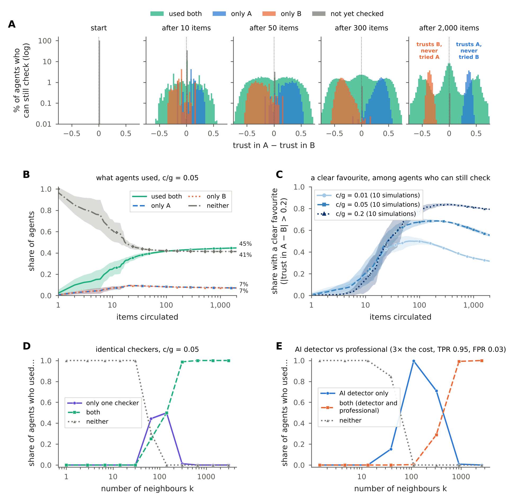

# Deepfake percolation: costly checking and the split of trust

An agent-based model of how fake and genuine items spread through a social network when people can pay to check
them with an imperfect checker (an AI deepfake detector, a fact-checker) whose quality they learn only by using it.

## The question

Checking whether something is fake costs time or money, the checker makes mistakes, and nobody is told how good it
is: you find out by using it. What does that do to who checks, and to whom they come to trust?

The model's answer:

- **Who stops checking, and why.** Some people are *priced out*: their audience is so small that checking would not
  pay even if they knew exactly how good the checker is. Others are *trapped*: checking would pay, but their trust in
  the checker is too low to try it (from the start, or after a few unlucky checks). Because they no longer check,
  they never learn otherwise. Not checking is an absorbing state.
- **The split of trust.** With two *identical* checkers, chance differences in what people see and how their first
  checks turn out, amplified by how much each of them has at stake, make otherwise identical people settle on
  different checkers. They then stay with that checker because they never try the other one.
- **Consequences.** The more people stop checking, the smaller the head start genuine items have over fakes, and the
  lower welfare is.

## How the model works

Agents sit on an undirected network. In the main setting this is a Twitter follower network of news-sharing accounts,
with 14,128 nodes and mutual follows only (Nikolov et al. 2021). At each time step one item enters at a random agent.
The item is fake with probability φ.

1. **Estimate.** An agent who receives the item from neighbour *j* estimates the probability that it is genuine from
   *j*'s track record, shrunk towards its own belief πᵢ about the share of genuine items:
   p = (n_genuine,ij + 2πᵢ) / (n_ij + 2).
2. **Decide.** The agent picks whichever action has the highest expected payoff:
   - **share**: +g·sᵢ if the item is genuine, −ℓ·sᵢ if it is fake, where sᵢ = kᵢ/⟨k⟩ is the agent's audience
     relative to the mean degree;
   - **check**: pay *c*, then share unless the checker flags the item. The checker flags fakes with probability TPR
     and genuine items with probability FPR;
   - **discard**: payoff 0.
3. **Learn.** After the cascade, the truth is revealed to everyone the item reached. They update πᵢ and their record
   of the sender (Beta counts). Only agents who checked update their beliefs about the checker's TPR and FPR.

**The threshold.** Checking can only pay if the agent's believed informativeness of the checker,
Ĵᵢ = t̂ᵢ − f̂ᵢ, exceeds

  θᵢ = (c / sᵢ) · (1/g + 1/ℓ).

Below θᵢ an agent never checks again, so it never learns again. Agents with θᵢ above the checker's actual quality
J = TPR − FPR are priced out. Agents below that line who have stopped anyway are trapped. A one-agent
"first-passage" model of this barrier (`model_v2/trapmodel.py`) predicts the simulated share not checking without any
fitting.

**Defaults.** Checker R2: TPR 0.80, FPR 0.10 (J = 0.70), the best commercial AI detector on in-the-wild media.
Everyone starts with the same beliefs about the checker (TPR ~ Beta(2,1), FPR ~ Beta(1,2), so starting trust
J₀ = 1/3). Starting beliefs about the share of genuine items are spread out: U(0.01, 0.99), weight 2. Main setting:
φ = 0.3, c/g = 0.05, ℓ/g = 2. Each run circulates 2,000 items with a burn-in of 1,000. Decisions and welfare depend
only on c/g and ℓ/g, so g = 1 in the code.

**Two checkers** (`K=2`). An agent can check with A, with B, or with both at the combined cost. After checking with
both, it shares under whichever of the AND and OR rules has the higher expected payoff given its beliefs.

The full specification, every switch in `engine.run()`, and the differences from the original Julia model are in
[`model_v2/README.md`](model_v2/README.md). Every result and setting decision is in
[`model_v2/RESULTS_v3.md`](model_v2/RESULTS_v3.md).

## Key figure



**Two identical checkers, A and B** (TPR 0.80, FPR 0.10; identical starting beliefs about both; c/g = 0.05; 10
simulations per line).

- **(A)** Among agents who can still check, trust in A minus trust in B starts as a single spike at 0. It splits into
  agents who trust both, agents who trust A and never tried B, and agents who trust B and never tried A.
- **(B)** After 2,000 items, 45% of agents have used both checkers, 7% only A, 7% only B, and 41% neither.
- **(C)** 56% of the agents who can still check have a clear favourite, meaning trust in one checker more than 0.2
  above trust in the other (79% at c/g = 0.2, 32% at c/g = 0.01). Among agents who checked at least once, trust in A
  and trust in B are negatively correlated (r = −0.34).
- **(D)** Audience size sorts the outcome: small accounts use neither checker, mid-sized accounts one, large
  accounts both.
- **(E)** With a cheap AI detector against a professional fact-checker at 3× the cost (TPR 0.95, FPR 0.03),
  mid-sized accounts use only the detector, and only large accounts pay for the professional.

The other main-text figures are the mechanism and the threshold (Fig. 1), one checker over time (Fig. 2), and the
regimes over φ and c/g with their consequences for reach and welfare (Fig. 4). They are in `figures/paper_v3/`.

## Running it

### Setup

The code needs Python 3.11 or later.

```bash
python3 -m venv ~/.venvs/dfp
~/.venvs/dfp/bin/pip install numpy pandas pyarrow scipy numba diptest matplotlib
```

The network edge lists go in `data/networks/`, which is not in git. Their sources and preprocessing are described in
`data/networks/README.md`. To keep them somewhere else, set `DFP_NETDIR`. `DFP_NPROC` sets the number of worker
processes.

### One simulation

This example uses a small generated network, so it runs in seconds without the data:

```python
import sys; sys.path.insert(0, "model_v2")
import config as C, engine as E
from sweep import summarize

params = {**C.BASE, **C.CHECKER, **C.MAIN}   # paper defaults: phi = 0.3, c/g = 0.05, l/g = 2, checker R2
R = E.run(**params, N=2000, m=5, seed=1)     # Holme-Kim network; use graph="twitter" for the real one
s = summarize(R)
print(s["frac_locked"], s["frac_trapped"], s["reach_true"], s["reach_fake"], s["dip4"] / 4)
```

Add `K=2` for two checkers. Results include the share not checking, the share trapped, the reach of genuine items
and of fakes, and the split of trust (Hartigan's dip; `dip4` stores 4 × dip).

On the Twitter network, one run of 2,000 items takes about 5–15 s per core.

### Reproducing the paper

```bash
cd model_v2
python synthnets.py                                    # random networks for Fig. S11
DFP_NPROC=6 bash run_on_mac_v3.sh                      # all experiments; restartable, ~3.5 h on 6 cores
python run_v3.py status  --out ../data/v3              # progress per experiment
python run_v3.py collect --out ../data/v3              # chunk files -> <experiment>.parquet
python gss_press.py extract ../GSS_stata/gss7224_r3a.dta ../data/gss/gss_press_extract.parquet   # Fig. S12
python make_figures_v3.py ../data/v3 ../figures/paper_v3   # every figure, PNG + PDF
```

`run_on_mac_v3.sh` sets up its own environment on first use and keeps the Mac awake while it runs. You can stop it
and start it again at any point; it picks up where it left off. To check the plumbing in a minute, run
`python run_v3.py run --tiny --out /tmp/dfp_tiny`, which uses a small network and short runs.

## Repository layout

| Path | Contents |
|---|---|
| `model_v2/` | Current model (Python/numba): `engine.py` (the model), `config.py` (defaults, checkers, networks), `exp_v3.py` + `run_v3.py` (experiments), `v3_fig*.py` + `make_figures_v3.py` (figures), `trapmodel.py` (one-agent model) |
| `model_v2/RESULTS_v3.md` | Decisions, numbers behind every figure, draft captions, open points |
| `figures/paper_v3/` | Paper and SI figures (not in git) |
| `data/` | Networks, simulation outputs, survey data (not in git) |
| `docs/` | Figures used in this README |
| `run_experiment.jl`, `analyze_*.py`, `notebooks/` | Original Julia model (v1) and its analysis. `model_v2/validate_vs_julia.py` checks that the Python engine reproduces it |
